# Claude themes

Animated dark themes for the Claude desktop app. Each chat gets a look that fits the work in it, and the background livens up while Claude is working.

<p>
  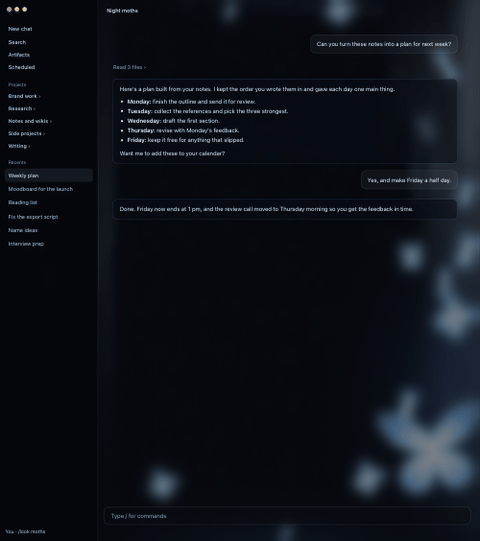
  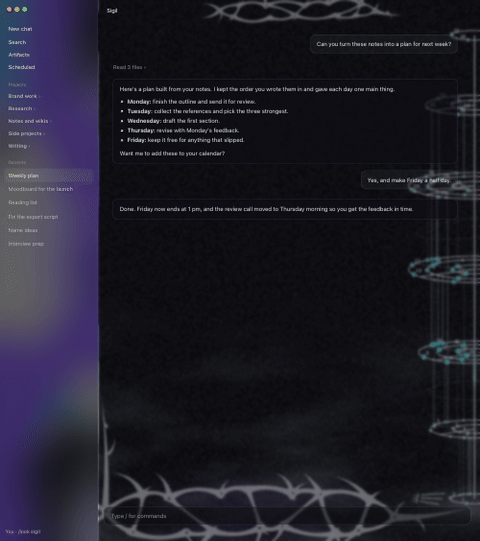
  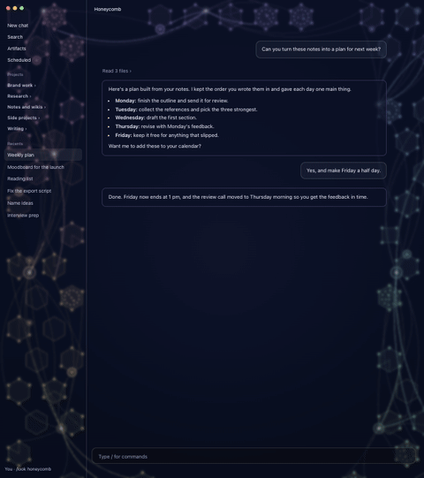
</p>

## Install

At the prompt of a terminal session:

```
/plugin install chat-looks --marketplace cvdvs/claude-themes
```

From a shell:

```bash
claude plugin install chat-looks --marketplace cvdvs/claude-themes
```

In the desktop app: click + next to the prompt box, then Plugins, Add marketplace with `cvdvs/claude-themes`, then Add plugin.

The themes show in the Claude desktop app. The terminal and code editors don't draw themes, so nothing changes there.

## The looks

Click a picture to see it move.

| | Look | What it is | Picked by words like |
|---|---|---|---|
| [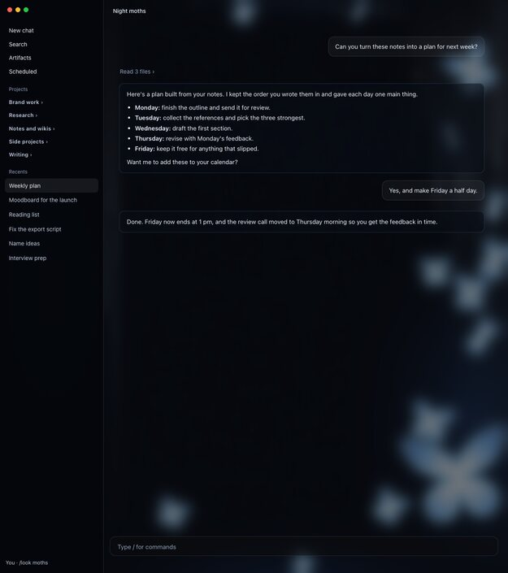](docs/motion/moths.gif) | `moths` | Glowing blue butterflies drift and flap at the edges, a crystal curtain sparkles, a stage beam slants in from the top. | astrology, tarot, moon, dream |
| [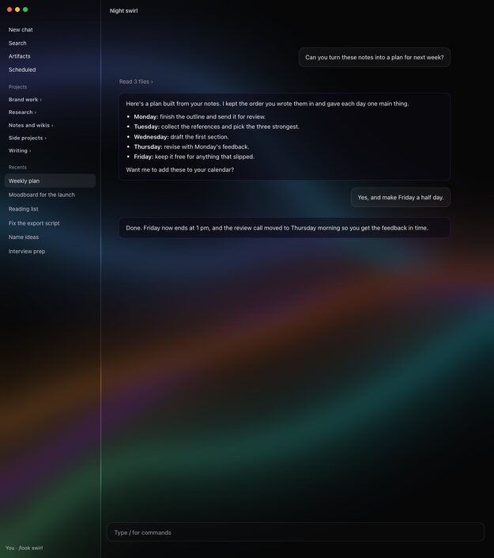](docs/motion/swirl.gif) | `swirl` | Neon ribbons in cyan, violet, magenta, orange and lime meet in a glowing knot on pitch black. | (pick it with `/look swirl`) |
| [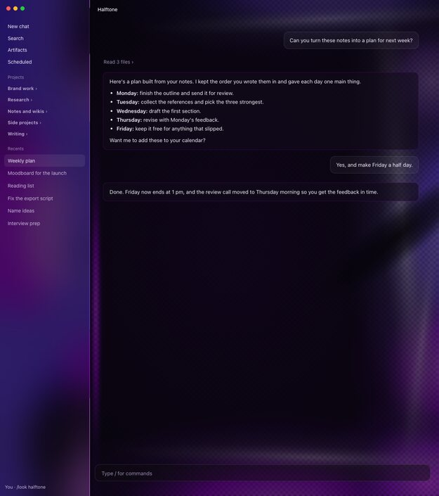](docs/motion/halftone.gif) | `halftone` | Electric purple glow behind a fine dot screen, with a dark shadow sweeping through the middle. | brand, logo, client, proposal |
| [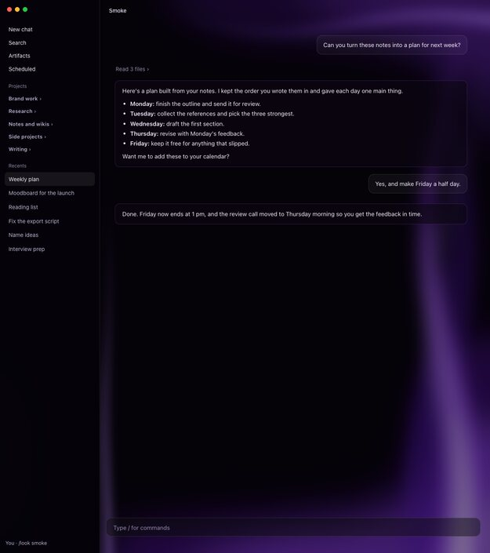](docs/motion/smoke.gif) | `smoke` | A purple smoke ribbon rising up the right edge, a glow pooling under the sidebar. | video, reel, social post, thumbnail |
| [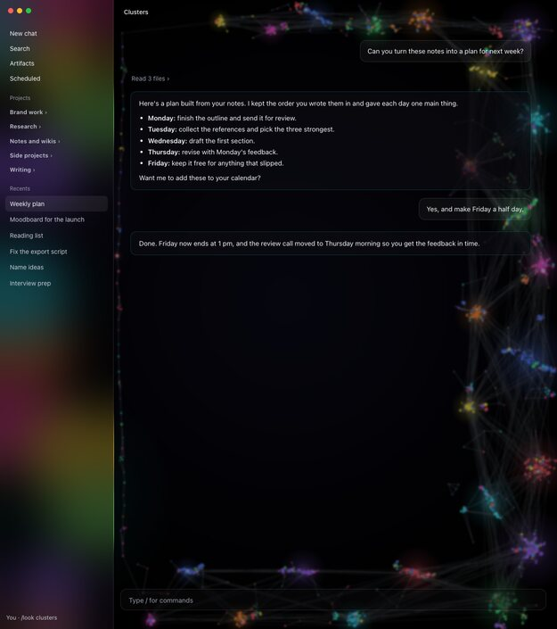](docs/motion/clusters.gif) | `clusters` | A graph view: colored node clusters joined by fine grey lines on black. Pulses run along the lines while Claude works. | research, audit, dataset, report |
| [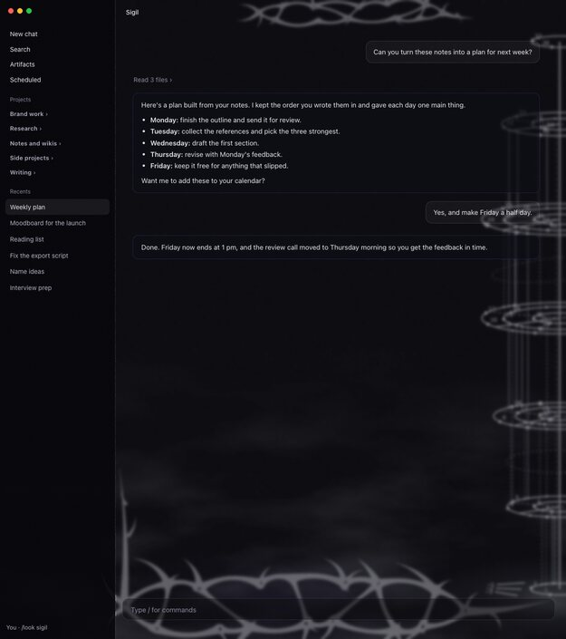](docs/motion/sigil.gif) | `sigil` | A tall white sigil under the sidebar, a diagram of stacked rings cut off by the right edge, film grain. | philosophy, essay, myth, occult |
| [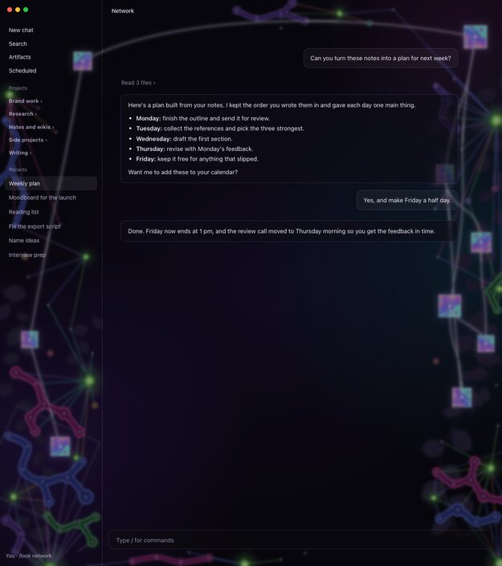](docs/motion/network.gif) | `network` | A note map: soft hull shapes, green starburst hubs and iridescent squares linked by white curves. | wiki, notes, obsidian, second brain |
| [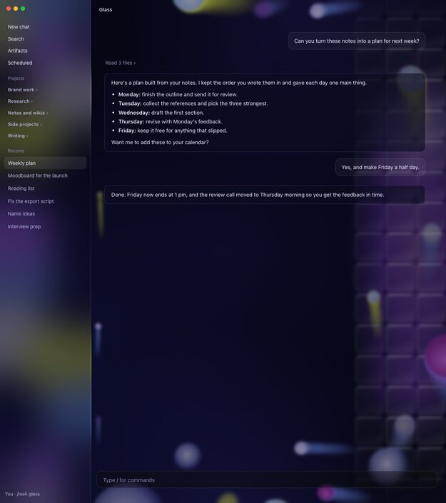](docs/motion/glass.gif) | `glass` | Glass bricks over a purple glow, soft circles drifting with yellow, blue and violet trails. | habit, music, journal, side project |
| [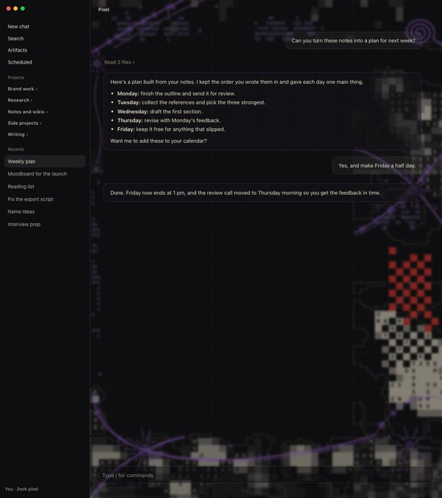](docs/motion/pixel.gif) | `pixel` | Pixel blocks packed with letters, a red checker, purple ink sweeps on dark graph paper. | game, arduino, firmware, pixel art |
| [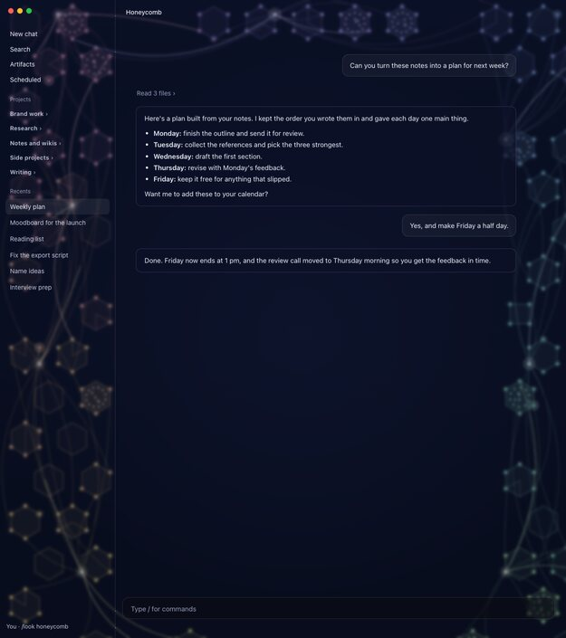](docs/motion/honeycomb.gif) | `honeycomb` | Hexagon cells with colored corners and curved lines that draw themselves in, on deep navy. | portfolio, case study, resume |
| [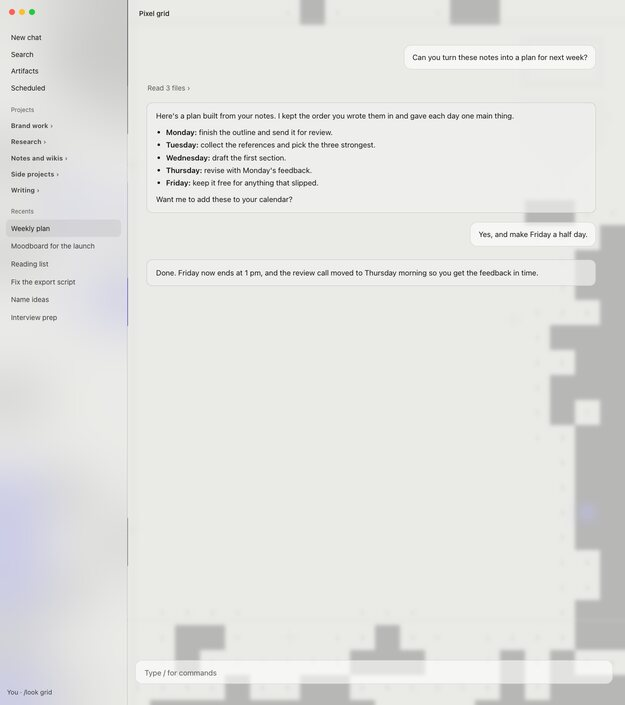](docs/motion/grid.gif) | `grid` | The one light look: black pixel masses and tiny numbers on pale paper. | (pick it with `/look grid`) |

## How a chat picks its look

You don't have to do anything. When a chat opens, it takes the first of these that applies:

1. The look you set in that chat before.
2. The look for the folder the chat started in, if you've listed that folder (see below).
3. The look whose words show up most in the chat's first messages.
4. The last look you picked anywhere.

To change it, type `/look` and a name, like `/look sigil`. That chat keeps it, and new chats that match nothing start with it too.

- `/look` on its own shows the chat's current look and the full list.
- `/look cards` turns the reply cards on or off. With cards on, each reply sits in a faint card in the look's colors.

## Make it yours

Everything lives in `hooks/looks.ts`. For each look you can:

- add your own project folders to `folders`, so a chat started in one always gets that look;
- add your own words to `words`, so a chat about that topic picks it;
- change the app colors, how much the panels blur over the art, and the reply card colors.

Each scene is one file in `hooks/scenes/`, a function that returns an SVG. Art sits under the sidebar, in the strip to the right of the chat and along the top and bottom edges, so the middle of the window stays quiet for reading. The scenes are drawn for a tall window, about 1250 × 1410, with the sidebar open; on a wider window they're cropped at the top and bottom.

Made by Claudia Vaduvescu with Claude Code.

## License

MIT, see [LICENSE](LICENSE). `hooks/make-colors.js` and `hooks/make-colors.d.ts` come from Claude Code's kit for building mods and aren't covered by this license.
